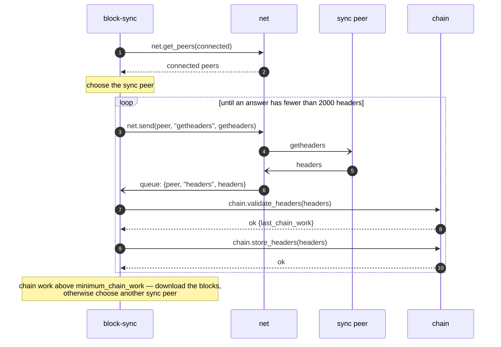
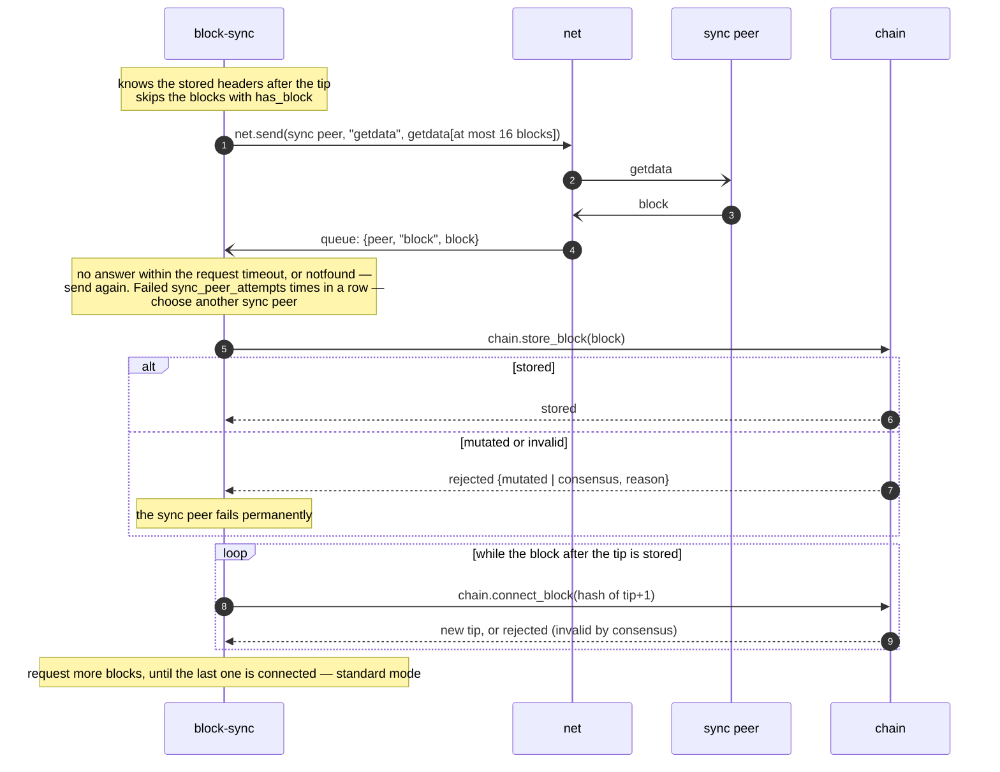

# Mode: Initial Block Download

The node is in IBD when, at start-up, the tip is the genesis block or its chain work is below `minimum_chain_work`
([modes](../modules/block-sync/state-machines.md#modes)): on the first launch, and after a restart that left the node
far behind. During IBD `block-sync` follows one peer, the sync peer; messages from every other peer are dropped. The
states and their failure handling are specified in the
[IBD machine](../modules/block-sync/state-machines.md#ibd-machine).

## Choosing the sync peer

`block-sync` calls `net.get_peers(connected)` and takes the peers whose features include `NODE_NETWORK` and
`NODE_WITNESS` and that have not failed permanently. It prefers a peer that has not failed; otherwise it takes the one
whose temporary failure is the oldest. If there is none, it tries again a second later.

A peer fails permanently when it sends invalid headers, a mutated block or a block invalid by consensus, and is never
chosen again during this IBD. Every other failure is temporary: its requests failed `sync_peer_attempts` times in a row
([failed requests](../modules/block-sync/state-machines.md#failed-requests)), it disconnected, or its chain is behind:
no more chain work than `minimum_chain_work`. When the sync peer fails, `block-sync` chooses another one and continues
from what is stored.

## Downloading headers

1. `block-sync` sends `getheaders` to the sync peer with the last header downloaded so far, if any, followed by a full
   locator of the active chain ([block locator](mode-standard.md#block-locator)). The parent of the first header in the
   answer is where the peer's chain leaves ours.
2. It validates each answer with `chain.validate_headers` and stores it with `chain.store_headers`, then sends the next
   `getheaders` with the last header received.
3. It continues until an answer has fewer than 2000 headers: the peer has no more.
4. If the chain work of the last header is above `minimum_chain_work`, the blocks are downloaded. Otherwise the sync
   peer is behind: `block-sync` chooses another one. The headers stay stored; the next sync peer may extend them.

Invalid headers (`validate_headers` rejected or `not_connected`) are a permanent failure of the sync peer; the headers
stored before them stay.

## Downloading blocks

Blocks are downloaded in the order of the headers
([BlocksDownload](../modules/block-sync/state-machines.md#blocksdownload)).

1. If the tip is on a fork that the downloaded headers leave, `block-sync` calls `chain.disconnect_tip` until the tip is
   the block where they leave the active chain. The tip is briefly lower; nothing else runs during IBD.
2. `block-sync` sends `getdata` (`MSG_WITNESS_BLOCK`) to the sync peer for the blocks after the tip, keeping at most 16
   in flight. Blocks which are already stored (`has_block`) are not requested.
3. When a block is received, `block-sync` calls `chain.store_block` with it. Mutated: a permanent failure of the sync
   peer. Invalid by consensus: the block is added to the
   [invalid blocks](../modules/block-sync/state-machines.md#invalid-blocks), the headers after it are dropped, and the
   sync peer fails permanently.
4. While the block after the tip is stored, `block-sync` calls `chain.connect_block` with its hash, and the tip moves to
   it. A rejection is handled as a block invalid by consensus.
5. `block-sync` requests more blocks, until the last block of the downloaded headers is connected. Then IBD is done and
   `block-sync` enters standard mode.

