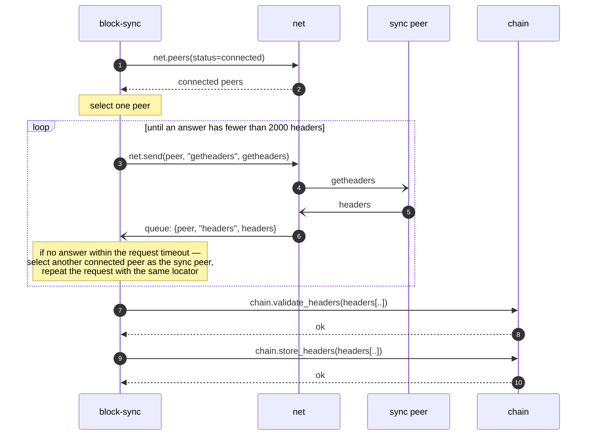
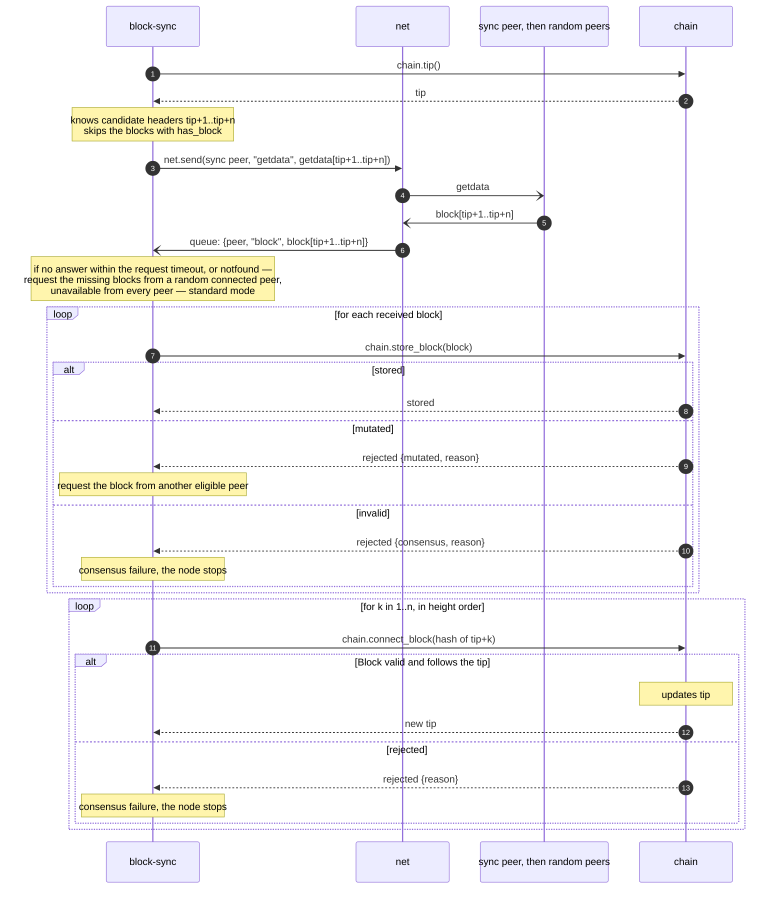

# Bode: Initial Block Download

During IBD all other processes are paused, except maintaining the connections with peers.
Messages in the `block-sync` queue that are not part of the IBD are skipped. A message is part of the IBD when it
answers a request `block-sync` sent for the IBD.

The node enters IBD on first launch, when the database is clear and tip is genesis block.

## Downloading headers

1. `block-sync` selects one connected peer, the sync peer, using `net` as the CRUD for peers.
2. `block-sync` requests `getheaders` from it, in batches of 2000 headers. The first request carries a locator of the
   active chain; each next request carries the last header
   received ([block locator](../modules/block-sync/README.md#block-locator)).
3. `block-sync` continues until it has downloaded all headers this peer knows: an answer with fewer than 2000 headers.
4. `block-sync` validates the whole header chain by calling `chain.validate_headers`, and stores it with
   `chain.store_headers`.

If a `getheaders` to the sync peer fails ([request timeout](../modules/block-sync/README.md#request-timeout)),
`block-sync` selects another random connected peer as the sync peer and repeats the request with the same locator; the
download resumes from the last header received. When every connected peer has failed in turn, `block-sync` waits
`request_timeout_secs` seconds and starts again with the first.

At this point the node has the ~full header history, validated on the header level only. The downloaded headers form the
candidate header chain.

---

## Downloading blocks

Blocks are downloaded from the beginning ([block download](../modules/block-sync/README.md#block-download)).

1. The current tip block is at height `tip`: all headers, and all blocks up to and including the tip block, are
   validated and stored.
2. `block-sync` knows the candidate headers `tip+1 ...`. Blocks which are already stored are not requested. For the
   others it sends `getdata` (`MSG_WITNESS_BLOCK`) to the sync peer; if the sync peer does not answer, to random
   eligible peers ([peer selection](../modules/block-sync/README.md#peer-selection)). Requests are made in batches (
   TBD).
3. When a block is received, `block-sync` calls `chain.store_block` with it. If the block is rejected:
    - `rejected {mutated}`: `block-sync` requests the block from another eligible peer.
    - `rejected {consensus}`: `block-sync` reports a consensus failure and the node stops.
4. When the block `tip+1` is stored, `block-sync` calls `chain.connect_block` with its hash. If the block is valid,
   `chain` moves the tip to it and `block-sync` continues from step 1. Otherwise the block is invalid by consensus while
   its header is valid: `block-sync` reports a consensus failure and the node stops.
5. If a block is unavailable from every eligible peer, `block-sync` switches to standard mode on the current tip
   ([unavailable block](../modules/block-sync/README.md#unavailable-block)).

