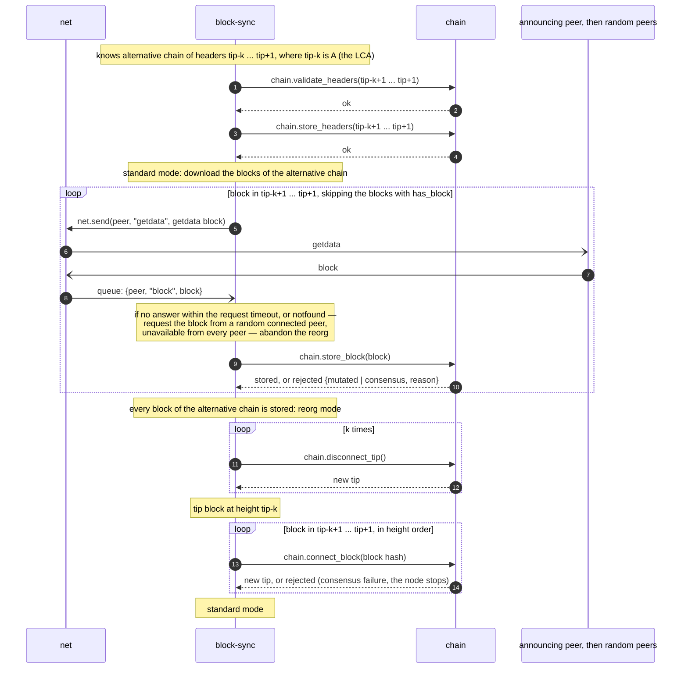

# Mode: Reorg

Reorg mode covers the disconnection of the node's blocks and the connection of the alternative chain's blocks. It
starts only when every block of the alternative chain is stored, so it sends no requests. During reorg mode all other
processes are paused, except maintaining the connections with peers; messages in the `block-sync` queue are consumed and
discarded.

Reorg happens if in the standard mode, we found a valid chain of headers A..B, where A belongs to the node's current
chain, every header (A+1)..B does not belong to the node's chain and the chain work of B is greater than the chain work
of the tip ([chain work](../modules/chain/README.md#chain-work)). It means that we found a chain with more work than
ours — so we have to reorganize our node. The chain of A..B usually appears when the node receives a header
with unknown parent, so it starts searching LCA as described
in [processing-headers](mode-standard.md#processing-headers).

Note: If the chain work of B is at most the chain work of the tip, it is not a reorg: the headers (A+1)..B are rejected
and not stored. On equal chain work the node keeps its current chain.

A reorg proceeds as follows, with k = tip − height(A):

1. `block-sync` stores the headers (A+1)..B with `chain.store_headers`.
2. `block-sync` downloads the blocks (A+1)..B ([block download](../modules/block-sync/README.md#block-download)): blocks
   that are already stored are not requested; the others are requested from the peer that announced B, and if it does
   not answer, from random eligible peers ([peer selection](../modules/block-sync/README.md#peer-selection)); each
   received block is stored with `chain.store_block` (a mutated block is requested from another eligible peer; a
   consensus rejection stops the node). During the block download, the node continues working in standard mode. If a
   block is unavailable from every eligible peer, the reorg is
   abandoned ([unavailable block](../modules/block-sync/README.md#unavailable-block)): the headers and the blocks stored
   so far stay, nothing else changes.
3. When every block of (A+1)..B is stored, `block-sync` enters reorg mode.
4. `block-sync` calls `chain.disconnect_tip` k times. The tip block is then A.
5. `block-sync` calls `chain.connect_block` for (A+1)..B in height order. A rejected block is a consensus failure:
   `block-sync` reports it and the node stops.
6. `block-sync` enters standard mode.

A rejected `store_block` or `connect_block` of the alternative chain is handled as in
[IBD](mode-ibd.md#downloading-blocks).

If the node crashes during reorg mode, it relaunches in standard mode. The tip is then at some block between A and B,
and every block of (A+1)..B is in `blocks`. The next announcement on the alternative chain finds its parent stored and
the LCA equal to the tip; the remaining blocks are connected from the store without being downloaded
([append new header](mode-standard.md#append-new-header)).
