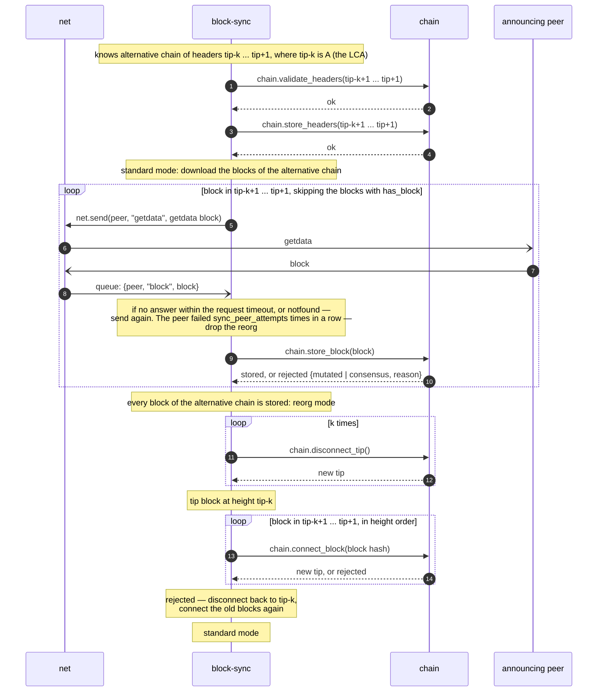

# Mode: Reorg

Reorg mode covers the disconnection of the node's blocks and the connection of the alternative chain's blocks. It
starts only when every block of the alternative chain is stored, so it sends no requests. It runs as the
[reorg machine](../modules/block-sync/state-machines.md#reorg-machine), from state to state until `ReorgDone`:
`block-sync` takes no tick and no message meanwhile, so messages wait in its
[queue](../modules/block-sync/state-machines.md#queue) and the requests of the other peer machines may fail. Only one
reorg runs at a time: a peer machine whose candidate is ready during a reorg decides again on the next tick after it.

Reorg happens if in the standard mode, we found a valid chain of headers A..B, where A belongs to the node's current
chain, every header (A+1)..B does not belong to the node's chain and the chain work of B is greater than the chain work
of the tip ([chain work](../modules/chain/README.md#chain-work)). It means that we found a chain with more work than
ours — so we have to reorganize our node. The chain of A..B usually appears when the node receives a header
with unknown parent, so it starts searching LCA as described
in [processing-headers](mode-standard.md#processing-headers).

Note: If the chain work of B is at most the chain work of the tip, it is not a reorg: the headers (A+1)..B are rejected
and not stored. On equal chain work the node keeps its current chain.

A reorg proceeds as follows, with k = tip − height(A):

1. `block-sync` stores the headers (A+1)..B with `chain.store_headers`.
2. `block-sync` downloads the blocks (A+1)..B
   ([DownloadBlocks](../modules/block-sync/state-machines.md#downloadblocks)): blocks that are already stored are not
   requested; the others are requested from the peer that announced B, at most 16 at a time, and each received block is
   stored with `chain.store_block`. During the block download, the node continues
   working in standard mode. A mutated or invalid block, or the peer failing `sync_peer_attempts` times in a row
   ([failed requests](../modules/block-sync/state-machines.md#failed-requests)), drops the reorg: the headers and the
   blocks stored so far stay, nothing else changes.
3. When every block of (A+1)..B is stored, `block-sync` finds the LCA of B again, locally, by walking back with
   `chain.header`: another reorg may have moved the tip since the LCA search, which changes k and the blocks to
   connect. All of them are stored: the candidate's blocks were downloaded, and the blocks between a lower LCA and A
   were on the active chain before. With at most the tip's chain work, the reorg is dropped. Otherwise `block-sync`
   enters reorg mode, with k = tip − height(A) for the LCA A found now.
4. `block-sync` records the blocks of the active chain after A and calls `chain.disconnect_tip` k times. The tip block
   is then A.
5. `block-sync` calls `chain.connect_block` for (A+1)..B in height order. If a block is rejected, it is added to the
   [invalid blocks](../modules/block-sync/state-machines.md#invalid-blocks) and the reorg is rolled back:
   `chain.disconnect_tip` until the tip is A, then `chain.connect_block` for the recorded blocks. A rejection while
   reconnecting them is a node failure: they were connected before.
6. `block-sync` enters standard mode. The other peer machines check their candidates against the new tip on the next
   tick: a candidate with at most the tip's chain work is dropped.

If the node crashes during reorg mode, it relaunches in standard mode. The tip is then at some block between A and B,
and every block of (A+1)..B is in `blocks`. The next announcement on the alternative chain finds its parent stored and
the LCA equal to the tip; the remaining blocks are connected from the store without being downloaded
([append new header](mode-standard.md#append-new-header)). A crash while rolling back leaves the tip on one of the two
chains, between A and the rejected block or between A and the old tip; the set of invalid blocks is lost with it, so an
announcement of the alternative chain leads to the rejected block once more, and the rollback runs again.
