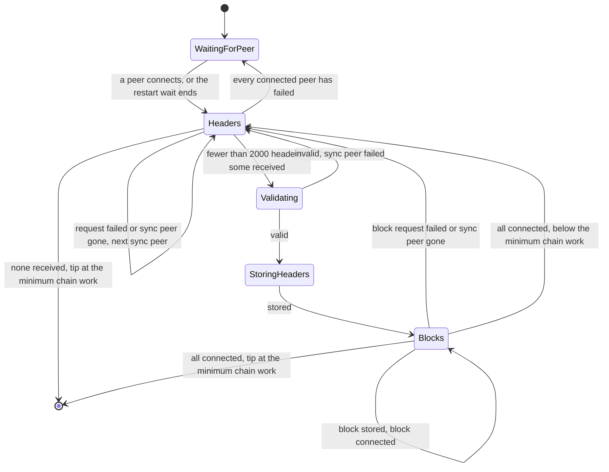
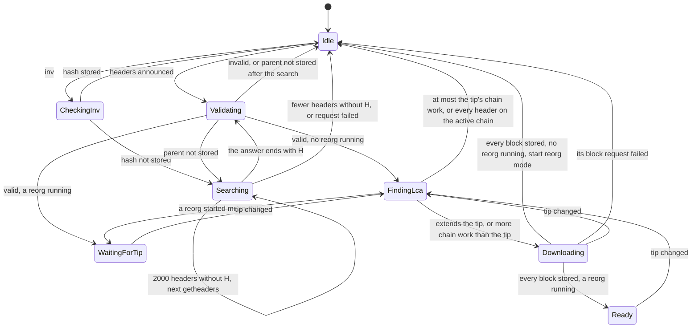
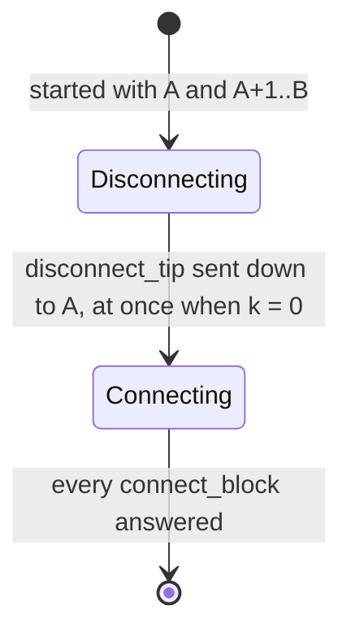
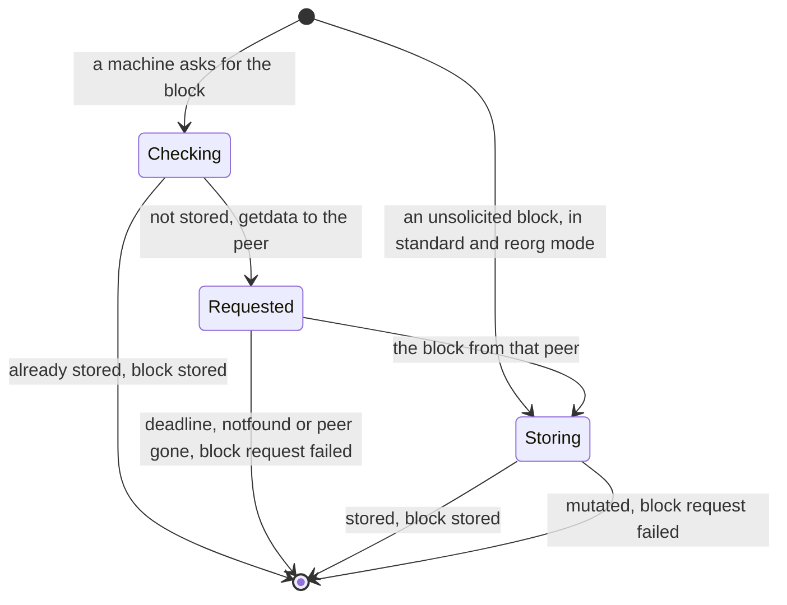

# block-sync machines

The state machines of `block-sync` ([internal structure](README.md#internal-structure)): what each one receives, what
it does, and when it changes state. A machine takes one input at a time with the context and returns effects; it does
no I/O. The flows themselves are described in [mode-ibd.md](../../flows/mode-ibd.md),
[mode-standard.md](../../flows/mode-standard.md) and [mode-reorg.md](../../flows/mode-reorg.md).

## Context

Every machine reads, never writes:

| Field                | What it is                                                                                   |
|----------------------|----------------------------------------------------------------------------------------------|
| tip                  | hash, height and chain work of the tip, as `chain`'s answers have left it                    |
| `minimum_chain_work` | the configured minimum ([configuration](README.md#configuration))                            |
| mode                 | IBD, standard or reorg; a peer machine waits for the tip while a reorg runs                  |
| connected peers      | the peers `net` has reported connected and not yet disconnected                              |

## Effects

| Effect                   | The shell                                                                             |
|--------------------------|---------------------------------------------------------------------------------------|
| send `getheaders`        | sends it to the peer and registers it, with its deadline, for the machine             |
| request to `chain`       | sends it and registers it for the machine                                             |
| fetch blocks from a peer | hands the block hashes to the block fetcher, which records the machine as a requester |
| enter standard mode      | ends IBD or the reorg                                                                 |
| start reorg mode         | creates the reorg machine with the LCA and the chain to connect                       |
| internal event           | queues it ([internal events](README.md#internal-structure))                           |

The block fetcher sends `getdata` itself, as a send effect of its own.

## Events and routing

An answer and a passed deadline go to the machine that owns the request. A request to `chain` past its deadline is
kept: `chain` always answers. Everything else is routed by mode:

| Event                         | In IBD                                                  | In standard and reorg mode                      |
|-------------------------------|---------------------------------------------------------|-------------------------------------------------|
| peer connected                | a new peer machine; IBD machine                         | a new peer machine                              |
| peer disconnected             | its peer machine is removed; IBD machine, block fetcher | its peer machine is removed; block fetcher      |
| `headers` answering a request | the request's owner                                     | the request's owner                             |
| `headers` not answering one   | dropped                                                 | the sender's peer machine                       |
| `inv`                         | dropped                                                 | the sender's peer machine                       |
| `block` answering a request   | block fetcher                                           | block fetcher                                   |
| `block` not answering one     | dropped                                                 | block fetcher                                   |
| `notfound`                    | block fetcher                                           | block fetcher                                   |
| internal event                | [internal events](README.md#internal-structure)         | [internal events](README.md#internal-structure) |

---

## IBD machine

Exists in IBD ([mode-ibd.md](../../flows/mode-ibd.md)). Ending it enters standard mode.

| State          | Input                                        | Effects, and the next state                                                                       |
|----------------|----------------------------------------------|---------------------------------------------------------------------------------------------------|
| WaitingForPeer | peer connected, restart deadline             | sync peer: a random connected peer not tried yet; a locator request, then `getheaders`: Headers   |
| Headers        | 2000 headers                                 | kept; `getheaders` from the last one                                                              |
| Headers        | fewer than 2000, some received in all        | `validate_headers` of all received: Validating                                                    |
| Headers        | none received in all                         | at the minimum chain work: enter standard mode; below: the sync peer failed                       |
| Headers        | request failed, sync peer disconnected       | the sync peer failed                                                                              |
| Validating     | valid                                        | `store_headers`: StoringHeaders                                                                   |
| Validating     | invalid at index i                           | the headers before i are kept; the sync peer failed                                               |
| StoringHeaders | stored                                       | fetch the first blocks from the sync peer: Blocks                                                 |
| Blocks         | block stored                                 | `connect_block` for each stored block next in height order; fetch more blocks                     |
| Blocks         | `connect_block` answered                     | counted; all connected: at the minimum chain work enter standard mode, below the sync peer failed |
| Blocks         | block request failed, sync peer disconnected | the sync peer failed                                                                              |

The sync peer failed: it is added to the peers tried, and the next random untried connected peer becomes the sync
peer. In Headers the download continues after the last header received; from Blocks the headers start again from the
tip, with nothing received. In Validating and StoringHeaders the request in flight goes on and the next sync peer takes
over after it. When every connected peer has failed, the peers tried are cleared and the machine waits
`request_timeout_secs` in WaitingForPeer.

In Blocks at most 16 blocks are fetched at a time (Core's `MAX_BLOCKS_IN_TRANSIT_PER_PEER`), none more than 1024 past
the next block to connect (Core's `BLOCK_DOWNLOAD_WINDOW`). `connect_block` requests do not wait for each other's
answers: `chain` runs writes in request order.

---

## Peer machine

One per connected peer, in every mode: its [candidate](README.md#candidates). It stays Idle in IBD, where nothing is
routed to it.

| State                                         | Input                                | Effects, and the next state                                                                 |
|-----------------------------------------------|--------------------------------------|---------------------------------------------------------------------------------------------|
| any                                           | headers announced                    | the candidate is replaced: `validate_headers`: Validating                                   |
| Idle                                          | `inv`                                | `header` of its last block hash: CheckingInv                                                |
| CheckingInv                                   | not stored                           | a locator request, then `getheaders` with `hash_stop` = H: Searching                        |
| Validating                                    | valid                                | FindingLca, or WaitingForTip while a reorg runs                                             |
| Validating                                    | parent not stored                    | announced headers: the LCA search, Searching; headers from the search: Idle                 |
| Searching                                     | `headers`                            | collected; ends with H: `validate_headers`: Validating; 2000 without H: next `getheaders`   |
| FindingLca                                    | LCA found                            | chain-work check; `store_headers` of the new headers; fetch the missing blocks: Downloading |
| Downloading                                   | block stored                         | removed from the missing; none missing: Ready, or start reorg mode if no reorg runs         |
| Downloading                                   | block request failed, its own        | Idle: the candidate is dropped                                                              |
| Downloading                                   | block request failed, another peer's | fetch the block from this peer                                                              |
| WaitingForTip, Downloading, Ready, FindingLca | tip changed                          | find the LCA again against the new tip: FindingLca                                          |

FindingLca ([processing headers](../../flows/mode-standard.md#processing-headers)): headers whose parent is the tip
need no walk. Otherwise `header_at` and `header` walk back from the parent to the active chain; if the parent is on it,
`header_at` walks forward past the headers that are on it too (the answer to a sparse locator starts below the fork).
A chain that does not extend the tip is kept only with more chain work than the tip. At most 16 of the candidate's
blocks are fetched at a time.

---

## Reorg machine

Exists in reorg mode ([mode-reorg.md](../../flows/mode-reorg.md)), with A (the LCA), its height and A+1..B. Ending it
enters standard mode and emits the tip changed.

`disconnect_tip` and then `connect_block` requests are sent without waiting for answers: `chain` runs writes in
request order. Each answer updates the tip. A rejected `connect_block` is a consensus failure: the node stops.

---

## Block fetcher

Always exists; one state per block, so a block is requested once whichever machines need it. It asks no other peer
when a request fails ([failed block request](README.md#failed-block-request)).

| State     | Input                           | Effects                                                                      |
|-----------|---------------------------------|------------------------------------------------------------------------------|
| —         | fetch asked                     | `header` of the block: Checking; a block in progress only adds the requester |
| Checking  | `has_block`                     | emit block stored                                                            |
| Checking  | not stored                      | `getdata` (`MSG_WITNESS_BLOCK`) to the peer the first requester named        |
| Requested | `block` from that peer          | `store_block`: Storing                                                       |
| Requested | deadline, `notfound`, peer gone | emit block request failed                                                    |
| Storing   | stored                          | emit block stored                                                            |
| Storing   | `rejected {mutated}`            | emit block request failed                                                    |
| Storing   | `rejected {consensus}`          | consensus failure: the node stops                                            |
| Storing   | header not stored (unsolicited) | dropped                                                                      |
