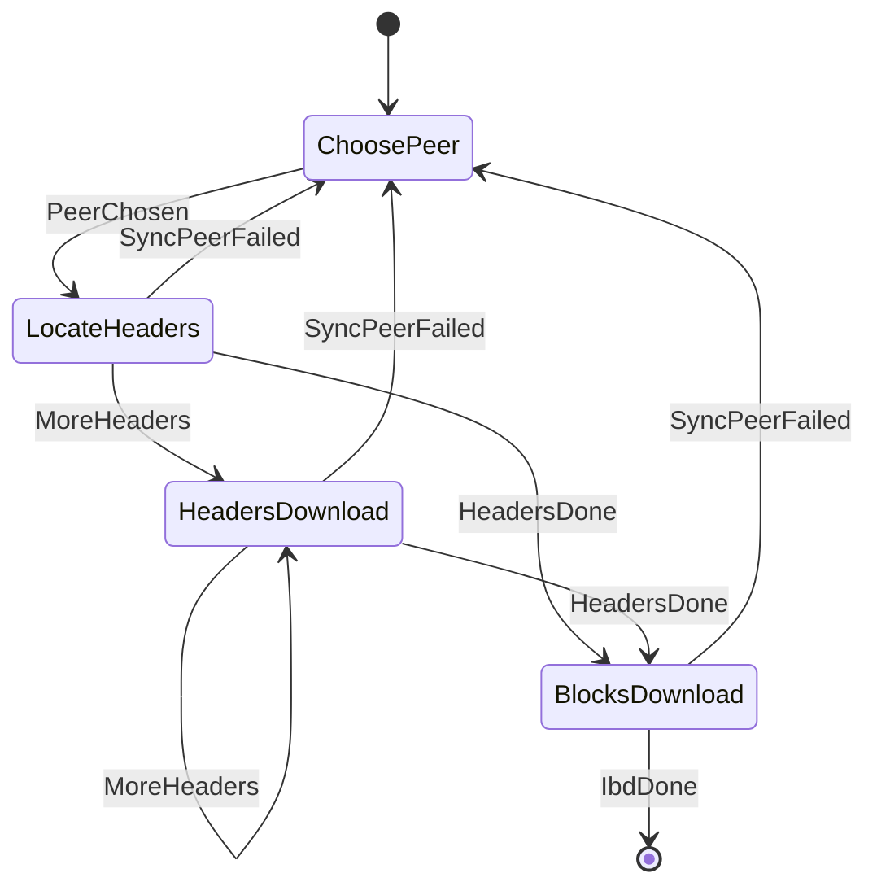
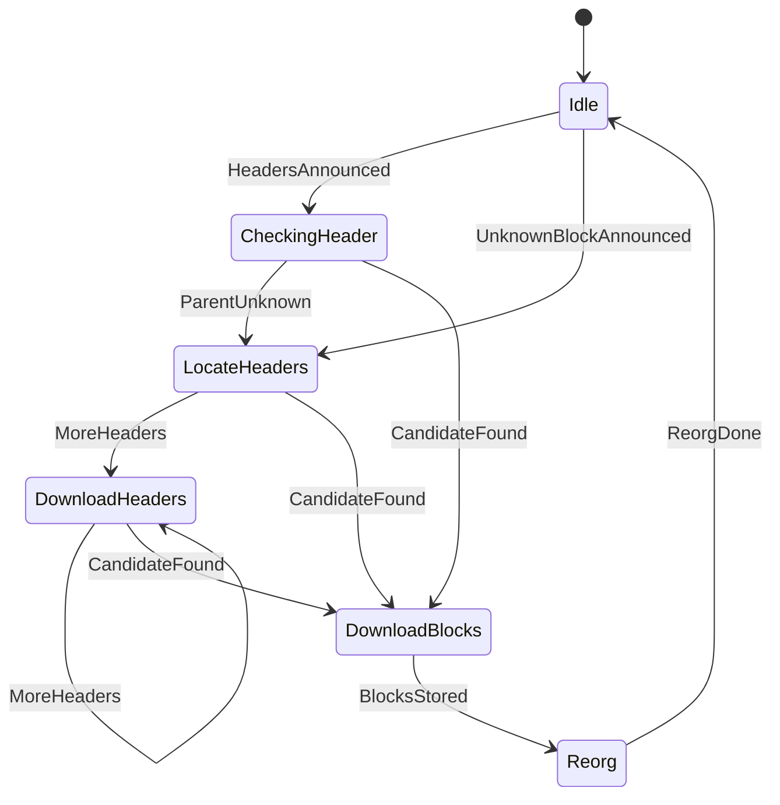
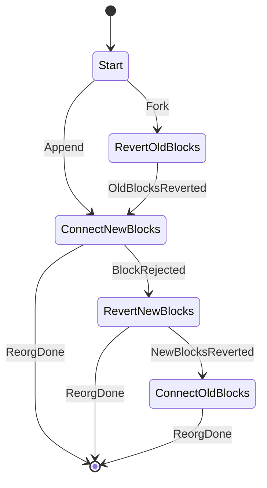

# block-sync state machines

`block-sync` is a loop around state machines: the IBD machine, one peer machine per connected peer, and the reorg
machine. This file specifies how a machine runs, the loop, what each machine can see and call (its context), and, for
each machine, its events and, for each state, what it holds and what it does. The flows
([IBD](../../flows/mode-ibd.md), [standard mode](../../flows/mode-standard.md), [reorg](../../flows/mode-reorg.md))
describe the same behaviour as sequences.

The machines are not meant to be exact at every moment, but to converge on the best chain over time. A decision may be
made on a tip that is about to change; every candidate is checked against the tip again before it changes the tip, so
such a decision costs some work and is corrected later, but never leaves the node on a worse chain.

## Calls and requests

In v0.1 calls to `chain` and `net` are synchronous: an action makes them and has their result at once. A request to a
peer is not: `net.send` returns at once and the answer arrives later through the queue, as an input of the machine that
sent it. Until then the machine waits in the state that sent the request; the request has a deadline
([failed requests](#failed-requests)).

Later, calls to `chain` become asynchronous as well: an action sends the call, the machine waits, and the answer comes
as an input, as a peer's answer does now. The states and events stay the same.

## Actions and transitions

A machine is a state, a plain tag, and the data of the machine. Its behaviour is two functions:

- The action of the current state, `act(input) -> Option<Event>`. It may call `chain` and `net` and change the machine's
  data, but never the state. It runs when its state is entered (the input `Enter`) and on every input that reaches the
  machine in that state: a peer message, the advance tick, the peers tick. `None` means the machine stays in its state
  and waits for the next input.
- The transition, `next(state, event) -> state`. It is pure: the new state depends only on the state and the event.

An event returned by an action is pushed to the internal queue. When the loop takes it, `next` gives the new state and
the new state is entered: its action runs with `Enter`. An event that leads back to the same state enters it again.

The data a state holds is in the machine, not in the state tag. Each state's `Enter` sets up the data it needs, and
each state's data is kept together, so that it is either all there or not at all. An action that finds its data missing
returns an error: a node failure.

Three events are taken by the loop rather than by the machine's `next`, because they change the mode:

| Event        | Emitted by        | The loop                                                                                                                                                                                                                                       |
|--------------|-------------------|------------------------------------------------------------------------------------------------------------------------------------------------------------------------------------------------------------------------------------------------|
| `IbdDone`    | the IBD machine   | ends the IBD machine and enters standard mode                                                                                                                                                                                                  |
| `StartReorg` | a peer machine    | creates the reorg machine with the LCA and the blocks to connect, and enters reorg mode; the peer machine stays in Reorg. While a reorg runs, the event is dropped: the peer machine stays in Reorg and decides again on the next advance tick |
| `ReorgDone`  | the reorg machine | ends the reorg machine, enters standard mode, and passes `ReorgDone` to the peer machine that started it                                                                                                                                       |

## The loop

`block-sync` runs one loop in one task: a single `tokio::select!` over four inputs, taken in this order of priority
(`biased`):

1. An internal event, while the internal queue is not empty: it goes to its machine, or to the loop.
2. The advance tick, every second: the machines of the current mode check whether their requests have
   [failed](#failed-requests).
3. The peers tick, every second: `block-sync` calls `net.get_peers(connected)` ([peers](#peers)).
4. A message from the [queue](#queue): it is [routed](#routing) to one machine.

The ticks and messages are disabled in reorg mode (a precondition of their branches), so while a reorg runs the loop
takes only internal events. The ticks come before messages because each is ready only once a second, so they cannot
hold the messages back, while messages could hold the ticks back. A tick missed while the loop is busy is not repeated:
the next one comes a second after the loop waits again.

Because internal events come first, a machine runs from state to state without other inputs in between, for as long as
its actions return events. The reorg machine always returns one until `ReorgDone`. The internal events of other
machines that were queued before the reorg started are taken during it as well: they may see the tip between two
chains, which the machines tolerate. More than 1000 internal events in a row is a bug that would never let the loop take
another input: it is a node failure.

### Modes

At start-up `block-sync` calls `chain.tip()`. It starts in IBD if the tip is the genesis block or its chain work is
below `minimum_chain_work` ([configuration](README.md#configuration)), and in standard mode otherwise. IBD ends with
`IbdDone`. Reorg mode lasts from `StartReorg` to `ReorgDone`. `block-sync` never returns to IBD.

### Queue

`net` pushes peer messages to the queue; `block-sync` takes them in order. The queue holds at most 256 MiB of payloads:
when a push would exceed that, the oldest messages are dropped until the new one fits. Dropping is safe: a dropped
answer is a request that fails on its deadline and is sent again, and a dropped announcement is caught up by the peer's
next one.

### Routing

| Input               | In IBD                                                   | In standard mode                        | In reorg mode                                     |
|---------------------|----------------------------------------------------------|-----------------------------------------|---------------------------------------------------|
| internal event      | its machine, or the loop                                 | its machine, or the loop                | its machine, or the loop; `StartReorg` is dropped |
| message from peer P | the IBD machine if P is the sync peer, dropped otherwise | P's peer machine; dropped if P has none | not taken                                         |
| advance tick        | the IBD machine                                          | every peer machine, in peer id order    | not taken                                         |
| peers tick          | the IBD machine, with the connected peers                | [peers](#peers)                         | not taken                                         |

A machine's action decides whether a message answers its request. A `headers` message answers a `getheaders` when it
is empty or the parent of its first header is in the request's locator. A `block` answers the `getdata` for its hash,
and a `notfound` the `getdata` for each hash it names. A `block` or `notfound` that answers no request is dropped; a
`headers` that answers none is an announcement.

### Peers

`net` sends no peer events. On the peers tick in standard mode, `block-sync` creates an Idle peer machine for every
connected peer without one, and removes the machines of the peers that are no longer connected. In IBD there are no
peer machines; the IBD machine gets the list of connected peers instead. When IBD ends, the peer machines are created on
the next peers tick.

### Invalid blocks

`block-sync` keeps a set of the blocks found invalid by consensus: `store_block` rejected `{consensus}`, or
`connect_block` rejected. A candidate chain that contains one of them is dropped. The set is in memory and is lost on a
restart: after a restart an invalid chain may be downloaded once more, and is found invalid again.

### Constants

| Constant           | Value   | Meaning                                                                                    |
|--------------------|---------|--------------------------------------------------------------------------------------------|
| tick interval      | 1 s     | of the advance tick and the peers tick                                                     |
| queue size         | 256 MiB | payloads in the queue                                                                      |
| events in a row    | 1000    | internal events the loop takes without another input; more is a node failure               |
| `MAX_HEADERS`      | 2000    | headers in one `headers` message                                                           |
| `BLOCKS_IN_FLIGHT` | 16      | `getdata` requests one machine keeps in flight, as Core's `MAX_BLOCKS_IN_TRANSIT_PER_PEER` |

## Context

An action reads and calls only what its context gives it. Every machine's context has the general part:

| Field                  | What it is                                      |
|------------------------|-------------------------------------------------|
| `net`                  | the [net](../net/README.md#interface) calls     |
| `chain`                | the [chain](../chain/README.md#interface) calls |
| now                    | the time the input is handled                   |
| `request_timeout_secs` | the deadline of a request to a peer             |

The rest of a context is the machine's own:

| Machine       | Its own context                                                                                                |
|---------------|----------------------------------------------------------------------------------------------------------------|
| IBD machine   | `sync_peer_attempts`, `minimum_chain_work`, the [invalid blocks](#invalid-blocks): reads them and adds to them |
| Peer machine  | `sync_peer_attempts`, the invalid blocks: reads them and adds to them                                          |
| Reorg machine | the invalid blocks: adds to them                                                                               |

Which calls a machine makes is in its state tables: the IBD machine calls `net.get_peers` and `net.send`, a peer
machine `net.send`, and the reorg machine only `chain`.

## Failed requests

A request has failed when it is not answered within `request_timeout_secs` of being sent, or when a `getdata` is
answered with `notfound`. The IBD and peer machines check their requests on the advance tick.

A machine counts the consecutive failures of its peer. An answered request sets the count to zero. The requests found
failed on one advance tick count as one failure, and they are sent again. When the count reaches `sync_peer_attempts`,
the peer has failed: the IBD machine records a temporary failure and returns `SyncPeerFailed`, a peer machine returns
`CandidateDropped`.

---

## IBD machine

The IBD machine downloads the header chain of one peer, the sync peer, then its blocks. It starts in ChoosePeer.

| Event            | Emitted by                                     | When                                                                                    |
|------------------|------------------------------------------------|-----------------------------------------------------------------------------------------|
| `PeerChosen`     | ChoosePeer                                     | a sync peer is chosen                                                                   |
| `MoreHeaders`    | LocateHeaders, HeadersDownload                 | an answer of 2000 headers is stored                                                     |
| `HeadersDone`    | LocateHeaders, HeadersDownload                 | the last answer is stored, and the candidate's chain work is above `minimum_chain_work` |
| `SyncPeerFailed` | LocateHeaders, HeadersDownload, BlocksDownload | the sync peer failed; the action has recorded the failure                               |
| `IbdDone`        | BlocksDownload                                 | the candidate's last block is connected; taken by the loop                              |

The machine keeps, in every state:

| Data      | What it is                                                                                                                                                                            |
|-----------|---------------------------------------------------------------------------------------------------------------------------------------------------------------------------------------|
| failures  | per peer: a temporary failure with its time, or a permanent failure. Kept for the whole IBD.                                                                                          |
| candidate | the header chain IBD syncs to: its base, a block of the active chain, and the stored headers after it in order, with the chain work of the last one. Kept when the sync peer changes. |

A peer has a permanent failure when it sent invalid headers (`validate_headers` rejected or `not_connected`), a mutated
block (`store_block` rejected `{mutated}`) or a block invalid by consensus. Every other failure is temporary: its
requests [failed](#failed-requests), it disconnected, or its chain has no more work than `minimum_chain_work`. The IBD
machine never chooses a peer with a permanent failure again.

In LocateHeaders, HeadersDownload and BlocksDownload, a peers tick without the sync peer among the connected peers is a
temporary failure: `SyncPeerFailed`.

### ChoosePeer

| Holds       | —                                                                                                                                                                                                                                                                          |
|-------------|----------------------------------------------------------------------------------------------------------------------------------------------------------------------------------------------------------------------------------------------------------------------------|
| On entering | Takes the connected peers whose features include `NODE_NETWORK` and `NODE_WITNESS` and that have no permanent failure. It chooses a peer without a failure, or, if every one has failed, the one whose temporary failure is the oldest.                                    |
| On input    | The advance tick and the peers tick: tries again, as on entering.                                                                                                                                                                                                          |
| Emits       | `PeerChosen`, with the chosen peer as the sync peer and its failure count at zero. With no peer to choose: `None`. This covers the start-up, while `net` is still connecting, and every peer having failed permanently, which waits for the operator to connect new peers. |

### LocateHeaders

| Holds       | the sync peer, the `getheaders` in flight with its time, the failure count                                                                                                                                                                                                                                                                                                                                                                                             |
|-------------|------------------------------------------------------------------------------------------------------------------------------------------------------------------------------------------------------------------------------------------------------------------------------------------------------------------------------------------------------------------------------------------------------------------------------------------------------------------------|
| On entering | Sends `getheaders` with the last header of the candidate, if any, followed by a full locator of the active chain ([block locator](../../flows/mode-standard.md#block-locator)), and no stop hash.                                                                                                                                                                                                                                                                      |
| On input    | `headers` answering the request. An empty answer: the peer has no headers after the locator. Otherwise the parent of the first header is where the peer's chain leaves ours: if it is on the active chain, it becomes the candidate's base and the candidate's headers are dropped; if it is one of the candidate's headers, the candidate is cut after it. The headers are then handled as in HeadersDownload. The advance tick: [failed requests](#failed-requests). |
| Emits       | as HeadersDownload; an empty answer is the last answer                                                                                                                                                                                                                                                                                                                                                                                                                 |

### HeadersDownload

| Holds       | the sync peer, the `getheaders` in flight with its time, the failure count                                                                                                                                                                                                                                                            |
|-------------|---------------------------------------------------------------------------------------------------------------------------------------------------------------------------------------------------------------------------------------------------------------------------------------------------------------------------------------|
| On entering | Sends `getheaders` with the last header of the candidate as the locator, and no stop hash.                                                                                                                                                                                                                                            |
| On input    | `headers` answering the request: validated with `chain.validate_headers`, stored with `chain.store_headers`, and added to the candidate. The advance tick: [failed requests](#failed-requests).                                                                                                                                       |
| Emits       | `MoreHeaders` for a full answer (2000 headers). For a shorter one, the last: `HeadersDone` if the candidate's chain work is above `minimum_chain_work`; otherwise the sync peer is behind, a temporary failure, `SyncPeerFailed`. Rejected or `not_connected`: a permanent failure, `SyncPeerFailed`; the headers stored before stay. |

The headers of a peer that is behind stay stored and in the candidate: another peer may extend them.

### BlocksDownload

| Holds       | the sync peer, the `getdata` requests in flight with their times (at most 16), the blocks stored but not connected, the failure count                                                                                                                                                                                                                                                                                     |
|-------------|---------------------------------------------------------------------------------------------------------------------------------------------------------------------------------------------------------------------------------------------------------------------------------------------------------------------------------------------------------------------------------------------------------------------------|
| On entering | If the tip is neither the candidate's base nor one of its headers, the tip is on a fork the candidate leaves: `chain.disconnect_tip` until the tip is the base. Then it requests blocks, as below.                                                                                                                                                                                                                        |
| On input    | A `block` answering a request is stored with `chain.store_block`; while the block after the tip is stored, it is connected with `chain.connect_block`. `notfound` and the advance tick: [failed requests](#failed-requests). After each input it requests, in the candidate's order after the tip, the blocks not in flight, keeping at most 16 in flight; a block whose `chain.header` has `has_block` is not requested. |
| Emits       | `IbdDone` when the candidate's last block is connected. A mutated block: a permanent failure, `SyncPeerFailed`. A block invalid by consensus (`store_block` or `connect_block`): it is added to the [invalid blocks](#invalid-blocks), the candidate is cut before it, a permanent failure, `SyncPeerFailed`. Otherwise `None`.                                                                                           |

---

## Peer machine

A peer machine follows the announcements of its peer in standard mode: it finds where the announced chain leaves ours,
downloads its headers and blocks, and starts a reorg when the chain has more work than ours
([processing headers](../../flows/mode-standard.md#processing-headers)). It starts in Idle. Every state but Idle can
also emit `CandidateDropped`, back to Idle; those edges are left out of the diagram.

| Event                   | Emitted by                                     | When                                                                                                                                                                                                       |
|-------------------------|------------------------------------------------|------------------------------------------------------------------------------------------------------------------------------------------------------------------------------------------------------------|
| `HeadersAnnounced`      | Idle                                           | a `headers` announcement that is not empty and contains no invalid block                                                                                                                                   |
| `UnknownBlockAnnounced` | Idle                                           | an `inv` with a block whose header is not stored                                                                                                                                                           |
| `ParentUnknown`         | CheckingHeader                                 | the parent of the first announced header is not stored                                                                                                                                                     |
| `MoreHeaders`           | LocateHeaders, DownloadHeaders                 | an answer of 2000 headers without H                                                                                                                                                                        |
| `CandidateFound`        | CheckingHeader, LocateHeaders, DownloadHeaders | the headers up to H are valid, have more chain work than the tip, and are stored                                                                                                                           |
| `BlocksStored`          | DownloadBlocks                                 | every block of the candidate is stored                                                                                                                                                                     |
| `StartReorg`            | Reorg                                          | on entering, or on the advance tick after a dropped one: the candidate still has more chain work than the tip; it carries the LCA and the blocks to connect; taken by the loop, dropped while a reorg runs |
| `ReorgDone`             | the reorg machine, passed on by the loop       | the reorg has ended                                                                                                                                                                                        |
| `CandidateDropped`      | every state but Idle                           | invalid headers or blocks, no more chain work than the tip, H gone from the peer's chain, or the peer failed                                                                                               |

A busy machine (in any state but Idle) drops announcements: its action returns `None`, and the peer's next announcement
catches up. The candidate is the stored header chain the machine downloads, given by its last header. Its LCA is found
by walking back from that header with `chain.header` until a header of the active chain (`chain.header_at` of its height
returns it).

### Idle

| Holds       | —                                                                                                                                                               |
|-------------|-----------------------------------------------------------------------------------------------------------------------------------------------------------------|
| On entering | Drops the data of the previous candidate.                                                                                                                       |
| On input    | `headers` (an announcement), and `inv`: its `MSG_BLOCK` hashes; H is the last one whose `chain.header` is not found. Every other input is dropped.              |
| Emits       | `HeadersAnnounced` for a `headers` that is not empty and contains no invalid block. `UnknownBlockAnnounced` with H for an `inv` that has one. Otherwise `None`. |

### CheckingHeader

| Holds       | the announced headers; H is the last one                                                                                                                                                                                                                                                                                                                                |
|-------------|-------------------------------------------------------------------------------------------------------------------------------------------------------------------------------------------------------------------------------------------------------------------------------------------------------------------------------------------------------------------------|
| On entering | Looks up the parent of the first header with `chain.header`. If it is stored: `chain.validate_headers`, and if the chain work of H (`last_chain_work`) is above the tip's, `chain.store_headers`.                                                                                                                                                                       |
| On input    | none: it always emits on entering                                                                                                                                                                                                                                                                                                                                       |
| Emits       | `ParentUnknown` with H when the parent is not stored. `CandidateFound` with H as the candidate when the headers are stored. `CandidateDropped` when they are rejected or have at most the tip's chain work: nothing is stored. When the parent is the tip, the LCA is the tip: the reorg appends ([append new header](../../flows/mode-standard.md#append-new-header)). |

### LocateHeaders

| Holds       | H, the `getheaders` in flight with its time, the failure count                                                                                                                                                                                  |
|-------------|-------------------------------------------------------------------------------------------------------------------------------------------------------------------------------------------------------------------------------------------------|
| On entering | Sends `getheaders` with a full locator of the active chain and the stop hash H.                                                                                                                                                                 |
| On input    | `headers` answering the request; the advance tick: [failed requests](#failed-requests).                                                                                                                                                         |
| Emits       | An answer that ends with H: the headers are complete, handled as below. `MoreHeaders` for 2000 headers without H. `CandidateDropped` for fewer without H, or an empty answer: H is no longer on the peer's chain; and when the peer has failed. |

### DownloadHeaders

| Holds       | H, the headers collected, the `getheaders` in flight with its time, the failure count |
|-------------|---------------------------------------------------------------------------------------|
| On entering | Sends `getheaders` with the last header collected as the locator and the stop hash H. |
| On input    | as LocateHeaders                                                                      |
| Emits       | as LocateHeaders                                                                      |

When the headers are complete they are validated with `chain.validate_headers`. Rejected, containing an invalid block,
or with at most the tip's chain work at H: `CandidateDropped`, nothing stored. Otherwise `chain.store_headers` and
`CandidateFound` with H as the candidate.

### DownloadBlocks

| Holds       | the candidate's blocks after its LCA, the `getdata` requests in flight with their times (at most 16), the failure count                                                                                                                                                                                                                                                                                              |
|-------------|----------------------------------------------------------------------------------------------------------------------------------------------------------------------------------------------------------------------------------------------------------------------------------------------------------------------------------------------------------------------------------------------------------------------|
| On entering | Finds the candidate's blocks after its LCA and requests them, as below.                                                                                                                                                                                                                                                                                                                                              |
| On input    | A `block` answering a request is stored with `chain.store_block`. `notfound` and the advance tick: [failed requests](#failed-requests). On the advance tick it also checks the candidate against the tip, which a reorg of another machine may have moved. After each input it requests the candidate's blocks not in flight from its peer, keeping at most 16 in flight; a block with `has_block` is not requested. |
| Emits       | `BlocksStored` when every block is stored. `CandidateDropped` for a mutated block; for a block invalid by consensus, which is added to the [invalid blocks](#invalid-blocks); when the candidate has at most the tip's chain work or contains an invalid block; and when the peer has failed. Otherwise `None`.                                                                                                      |

### Reorg

| Holds       | the candidate                                                                                                                                                                                                                                |
|-------------|----------------------------------------------------------------------------------------------------------------------------------------------------------------------------------------------------------------------------------------------|
| On entering | Finds the LCA of the candidate again, since the tip may have moved since it was found, and checks the candidate's chain work against the tip once more.                                                                                      |
| On input    | `ReorgDone`. The advance tick, which only reaches the machine when its `StartReorg` was dropped because another reorg was running: it decides again, as on entering.                                                                         |
| Emits       | `StartReorg` with the LCA and the candidate's blocks after it; the machine stays in Reorg until `ReorgDone`, or until the next tick when the loop dropped the event. `CandidateDropped` when the candidate has at most the tip's chain work. |

---

## Reorg machine

The reorg machine moves the tip from the active chain to a candidate whose blocks are all stored. It sends no requests.
While it runs, the loop takes no tick and no message: messages wait in the [queue](#queue) and the requests of the
other machines may fail. It starts in Start, which decides the path. Appending is a reorg with k = 0, where k =
tip − height(LCA). Each state's action does all of its work on entering and emits one event.

| Event               | Emitted by                                                  | When                                                                                      |
|---------------------|-------------------------------------------------------------|-------------------------------------------------------------------------------------------|
| `Fork`              | Start                                                       | k > 0: the tip is not the LCA; the old blocks are recorded                                |
| `Append`            | Start                                                       | k = 0: the tip is the LCA                                                                 |
| `OldBlocksReverted` | RevertOldBlocks                                             | the tip is the LCA                                                                        |
| `BlockRejected`     | ConnectNewBlocks                                            | `connect_block` rejected a block, which is added to the [invalid blocks](#invalid-blocks) |
| `NewBlocksReverted` | RevertNewBlocks, when k > 0                                 | the tip is the LCA again                                                                  |
| `ReorgDone`         | ConnectNewBlocks, RevertNewBlocks (k = 0), ConnectOldBlocks | the reorg has ended, connected or rolled back; taken by the loop                          |

| State            | On entering                                                                                                                                                           | Emits                                                      |
|------------------|-----------------------------------------------------------------------------------------------------------------------------------------------------------------------|------------------------------------------------------------|
| Start            | Computes k from the tip's height and the LCA's. When k > 0, records the active chain's blocks after the LCA (`chain.header_at`), to connect them again on a rollback. | `Fork` when k > 0, `Append` when k = 0                     |
| RevertOldBlocks  | Calls `chain.disconnect_tip` k times. The tip is then the LCA.                                                                                                        | `OldBlocksReverted`                                        |
| ConnectNewBlocks | Calls `chain.connect_block` for the candidate's blocks in height order, until one is rejected.                                                                        | `ReorgDone` when every block is connected, `BlockRejected` |
| RevertNewBlocks  | Calls `chain.disconnect_tip` until the tip is the LCA.                                                                                                                | `NewBlocksReverted` when k > 0, `ReorgDone` when k = 0     |
| ConnectOldBlocks | Calls `chain.connect_block` for the recorded blocks in height order. The tip is the old tip again.                                                                    | `ReorgDone`                                                |

`ReorgDone` carries whether the candidate was connected or rolled back, for logging. A rejection in ConnectOldBlocks,
whose blocks were connected before, and any error from `chain` other than a rejection, are an error of the action: a
node failure.
